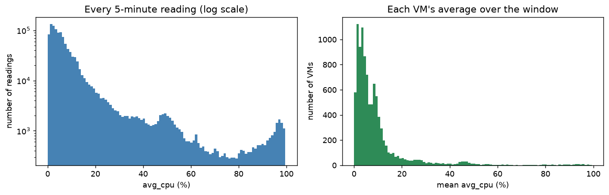
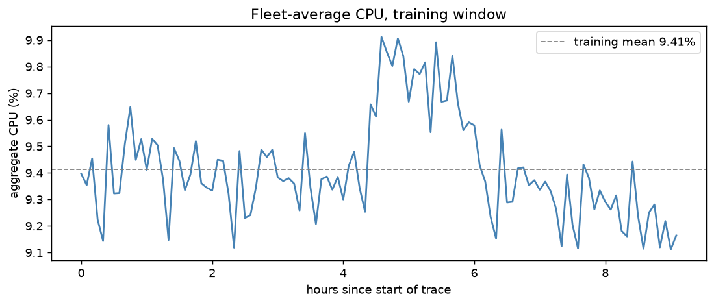
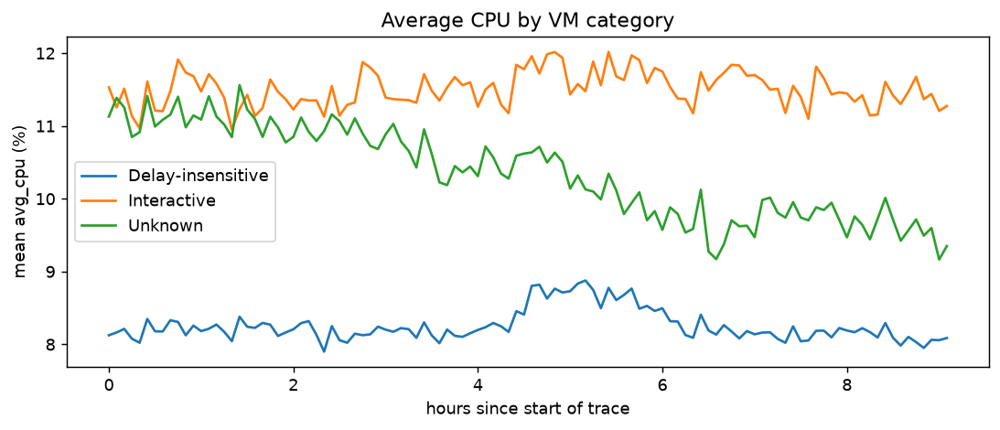
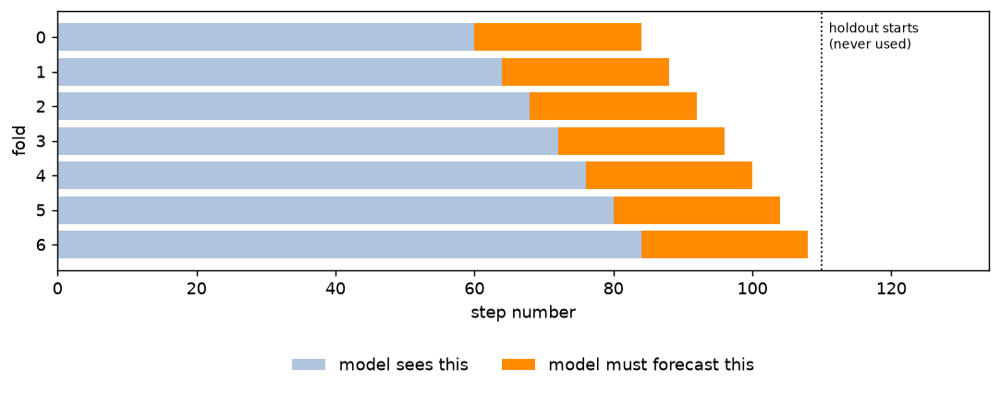
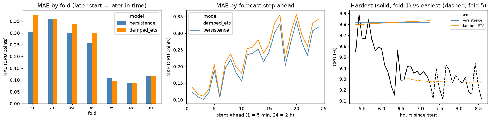
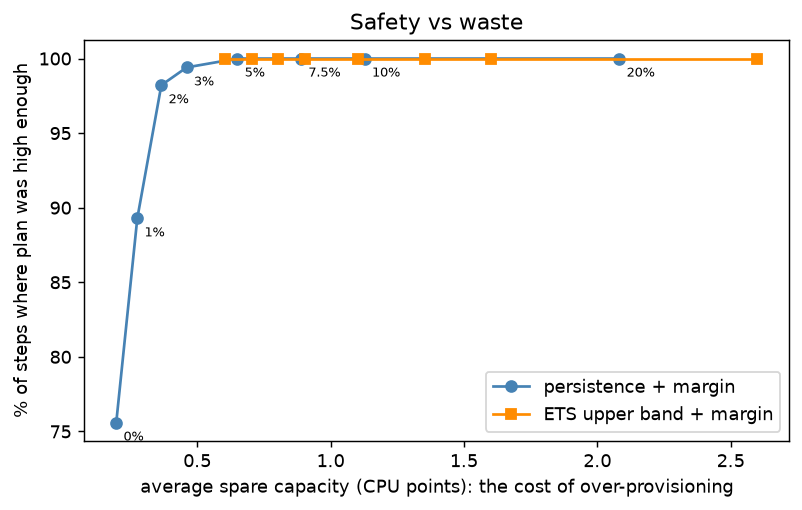
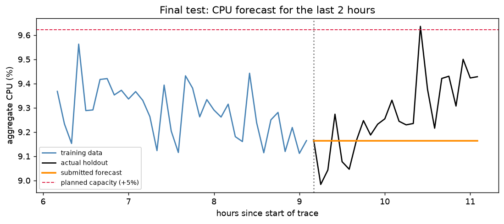

# Cloud Workload Forecasting: My Final Report

Azure Public Dataset V2 subset (`data-v1`): 10,000 VMs, 134 five-minute steps each (about 11.1 hours).
All numbers below come from `notebooks/cloud_workload_forecasting.ipynb` and you can reproduce it with the command in the README.

## 1. Executive summary

**How predictable is the workload?** Very, at fleet level. The number of running VMs never changes its still 10,000 at every step, and the fleet-average CPU stays between 9.1% and 9.9%.

**How accurately can the next 2 hours be forecast?** For CPU, a simple "stay at the latest value" forecast (persistence) is off by about **0.22 CPU points on average** in rolling validation about 2.3% in relative terms, and by about **0.15 points** on the real 2-hour holdout. So the VM count is forecast exactly.

**Also did the main model beat my baseline?** No. Damped-trend ETS was about **9% worse** than persistence on MAE i.e 0.239 vs 0.219, also worse on RMSE and on peak steps, i report this as found. The pipeline chooses the model by validation error, so the submitted forecast is the persistence baseline for both targets.

**What should an infrastructure team do?** Plan for `latest fleet CPU x 1.05`, recalculated every 5 minutes. On the validation folds this was high enough in every step with only about 0.65 CPU points of spare room, on the real holdout it was high enough in 23 of 24 steps one miss of 0.013 points. Protect the hot tail of VMs separately, because the fleet average hides it.

## 2. Data understanding and preprocessing

| Check | Result |
|---|---|
| Rows / VMs / timestamps | 1,340,000 / 10,000 / 134 |
| Cadence | Exactly 300 s between all consecutive timestamps so no gaps |
| Duplicate (VM, time) rows | 0 |
| Missing `avg_cpu`, values outside 0-100 | 0, 0 |
| Readings per VM | 134 for every VM |
| VM lifetimes | All VMs created before the window starts; none deleted inside it (zero churn) |

**Targets.** `active_vm_count` = distinct VMs with a valid reading at that time. `aggregate_cpu_utilization` = mean of VM `avg_cpu` at that time, in percent. Rules for bad data not triggered on this file, but implemented and tested: a missing or out-of-range `avg_cpu` is invalid and dropped; a VM is counted once per timestamp; a timestamp with no valid reading gets count 0 and CPU `NaN`, never an invented value. No resampling was needed, so the five-minute cadence is used directly.

**Split.** The full series was built first, then cut chronologically: first 110 steps for training, last 24 for the holdout. All exploration, model selection and policy tuning used the 110 training steps only.

## 3. Workload analysis

* **Idle majority, hot tail.** About 46% of VMs average under 5% CPU. About 2.2% average over 50%, and 17.1% touch 90% or more at least once. The busiest 1% of VMs account for 9.6% of all CPU use. Why it matters is because the fleet is mostly paid-for idle capacity, a rightsizing opportunity, but a minority of VMs run hot and need protecting.
* **Smooth average.** Because the average is taken over 10,000 VMs and is dominated by the quiet ones, it moves very little: mean 9.41%, standard deviation 0.19, typical 5-minute change 0.16 points.
* **One hump, no cycles.** The fleet average rises by about a third of a point i.e about half a point at its highest for roughly an hour and a half (hours 4.5 to 6), then drops back. With about 9 hours of history we cannot see any daily or weekly pattern.

* **Segments differ.** Interactive VMs average 11.5% CPU with a standard deviation of 17.0; Delay-insensitive VMs average 8.3% with 12.0; the small Unknown group averages 10.4% with 17.8. Two-core VMs are about 75% of the fleet and dominate the average.
* **The hump is fleet-wide.** During the hump (compared with the time before it), Delay-insensitive CPU was 0.48 points higher and Interactive 0.34 higher, while the small Unknown group, which drifts steadily downward through the whole window, was 0.69 lower. Several groups moving at once is hard to anticipate from the fleet average alone.
* **Peaks are sustained shifts.** The five highest readings all sit inside the hump (hours 4.6 to 5.7); four of the five lowest come in the last two hours, after the drop. *Why it matters:* the latest level is a good guide to the next hour, and a single reading is not a spike to ignore.

## 4. Forecasting approach

Two models, deliberately simple because there are only 110 training points:

1. **Persistence (baseline).** All future values equal the last observed value.
2. **Damped-trend ETS (main).** Exponential smoothing with a level and an additive trend that fades out over the horizon, fitted by maximum likelihood on the training data it is given. It also gives a 90% prediction interval. Seasonality is omitted because there is no full cycle to learn.

No engineered features are used. Both models see only the past values they are handed, and a unit test shows a forecast is unchanged if anything after the cut-off is altered. The VM-count series is constant, so ETS falls back to persistence there (the fallback is recorded in the output and tested).

**Mapping to the required timestamps.** No coarser cadence was used: forecasts are produced at the native five-minute steps, one per holdout timestamp, in order.

## 5. Validation methodology

Rolling-origin (expanding window) evaluation inside the 110 training points: the first fold trains on 60 points and forecasts the next 24; the origin then moves forward 4 steps, giving **7 folds** (train sizes 60, 64, ..., 84). This mirrors production, where a team forecasts the next 2 hours from the history so far. No shuffling, and the 24 holdout points are never touched. A "peak" step is one whose actual value is at or above the 75th percentile of that fold's own training data, so the label uses only past information. Model choice per target is a rule: lowest validation MAE, ties to persistence.

## 6. Results versus baseline

CPU (7 folds x 24 steps = 168 forecast points per model):

| Model | MAE | RMSE | sMAPE % | Peak-step MAE | MAE ratio vs baseline |
|---|---:|---:|---:|---:|---:|
| Persistence | 0.2194 | 0.2745 | 2.31 | 0.1533 | 1.00 |
| Damped ETS | 0.2390 | 0.3002 | 2.51 | 0.1858 | 1.09 (8.9% worse) |

VM count: MAE, RMSE and sMAPE are exactly 0 for both models. The ratio versus baseline is 0 divided by 0, so it is reported as undefined instead of a made-up number.

sMAPE divides by |actual| + |forecast|, floored at 1e-8, so near-zero values cannot blow it up; CPU values are about 9%, nowhere near zero, so it is stable here.

**Final test on the real holdout (looked at once, after every choice was made):**

| Target | Submitted (persistence) MAE | RMSE | Damped ETS MAE (reference) |
|---|---:|---:|---:|
| `aggregate_cpu_utilization` | 0.1468 | 0.1848 | 0.1567 |
| `active_vm_count` | 0 | 0 | 0 |

The holdout window is calmer than the validation average, so errors are lower, but the ordering matches validation: persistence is ahead of damped ETS.

## 7. Error and failure analysis

| Fold | 0 | 1 | 2 | 3 | 4 | 5 | 6 |
|---|---:|---:|---:|---:|---:|---:|---:|
| Persistence MAE | 0.305 | 0.358 | 0.301 | 0.257 | 0.110 | 0.087 | 0.118 |
| Damped ETS MAE | 0.378 | 0.360 | 0.336 | 0.301 | 0.097 | 0.086 | 0.115 |
| Range of actual values in window | 0.74 | 0.74 | 0.73 | 0.46 | 0.45 | 0.33 | 0.33 |

* **Where it fails: when the fleet moves.** Folds 0-3 contain the hump rising and falling and have about three times the error of the calm folds 4-6. The correlation between how much the series moved inside a fold's window and persistence error is 0.92. Neither model has any signal that predicts the hump, which comes from many VMs changing together.
* **Error grows with distance.** MAE is about 0.12 at 5 minutes ahead and about 0.32 at 2 hours ahead (persistence).
* **Why ETS loses.** It is worse in the turbulent folds and about equal in the calm ones. That fits its trend term leaning the old way right after the series turns, while persistence catches the new level a step later. We cannot prove the mechanism from 7 folds. Both models also forecast a little high on average (+0.17 persistence, +0.20 ETS) because the series drifted down after the hump.
* **ETS interval is too narrow.** Its 90% interval contained the actual value only about 78% of the time, so it should not be used as a safety band without a margin.
* **Peak behaviour.** On peak steps (about 18% of steps) persistence is also better (0.153 vs 0.186 MAE).

## 8. Capacity-planning recommendation

**Decision:** how much CPU capacity to plan for over the next 2 hours. Under-provisioning (demand above plan) risks slowdowns and failed scale-ups; over-provisioning wastes money. The only knob is a margin: plan = forecast x (1 + margin), replayed on the validation folds.

| Margin | Covered (% of steps) | Avg spare (CPU points) | Worst shortfall (points) |
|---:|---:|---:|---:|
| 0% | 75.6 | 0.20 | 0.33 |
| 2% | 98.2 | 0.37 | 0.15 |
| 3% | 99.4 | 0.46 | 0.05 |
| **5%** | **100.0** | **0.65** | **0.00** |
| 10% | 100.0 | 1.13 | 0.00 |

**Policy.**

1. Plan for `latest fleet-average CPU x 1.05` over the next 2 hours, recomputed every 5 minutes. Use +3% if cost matters more than avoiding any shortfall, +10% if slowdowns are expensive.
2. Re-plan immediately if the live average moves about 0.5 points (roughly the size of the margin) away from the value the plan was built on, since the errors came from sustained shifts. This trigger is a rule of thumb that was not separately validated.
3. Give **Interactive** VMs extra per-VM headroom (hotter and more variable); the fleet average cannot protect the hot tail (2.2% of VMs average over 50%).
4. The bigger cost lever at fleet level is rightsizing: average CPU is only about 9%.
5. Plan VM count as "same as now" and monitor it; the same rule works if VMs start to churn.

The ETS upper band reaches full coverage with no margin and a similar spare room (about 0.60 points), so the two approaches are close; persistence plus margin is preferred for simplicity. **Out-of-sample check:** the +5% plan (9.62%) was high enough in 23 of the 24 holdout steps, with average spare room 0.35 points and one miss of 0.013 points.

## 9. Limitations and future work

* **Short history.** About 9 hours of training data: no daily or weekly pattern, seasonal methods impossible, and a 2-hour holdout is a small test.
* **One hump, seven overlapping folds.** "Persistence is at least as good as damped ETS here" is solid in direction but not a precise number.
* **No churn.** `active_vm_count` is constant, so that target shows no modelling skill; the code handles a changing count but this is only tested on fake data.
* **Fleet average only.** It hides the hot tail; per-VM or per-segment forecasts would be needed for real autoscaling.
* **Policy margin** was chosen on the same folds it was scored on, and the holdout showed one small miss, so treat 5% as a starting estimate to re-check.
* **No outside data** (deployments, time of day, weekday) was used. Metadata deletion times were used only to describe churn, never as inputs.

**Future work:** more history so that seasonality and larger test sets become possible; segment-level forecasts (category, core bucket); intervals calibrated on the fold errors rather than the model's own; a regime-shift detector; other small models (simple exponential smoothing, ridge on lagged values) tested only through the same rolling-origin protocol.

*Data: curated subset of the Microsoft Azure Public Dataset V2 (https://github.com/Azure/AzurePublicDataset); follow the upstream license and usage terms.*
